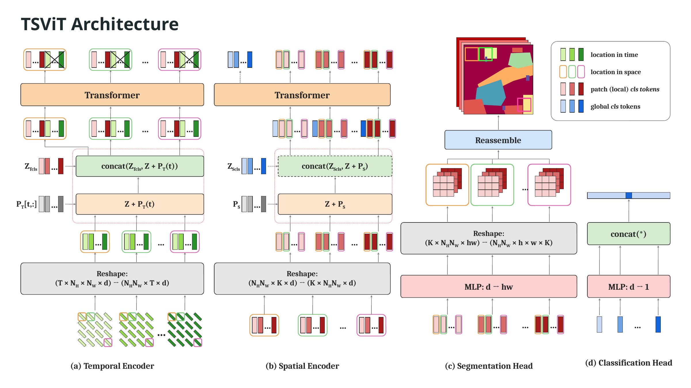
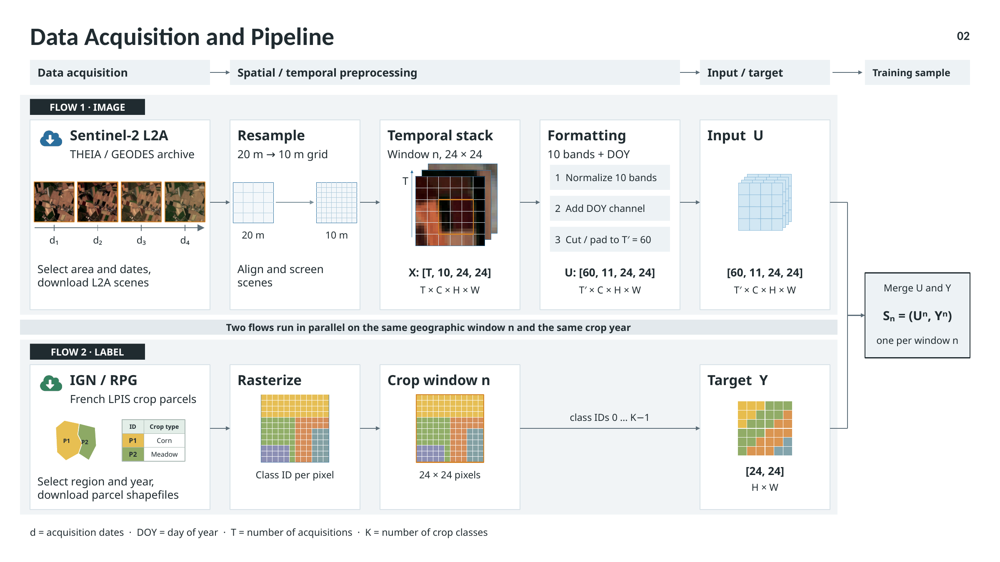
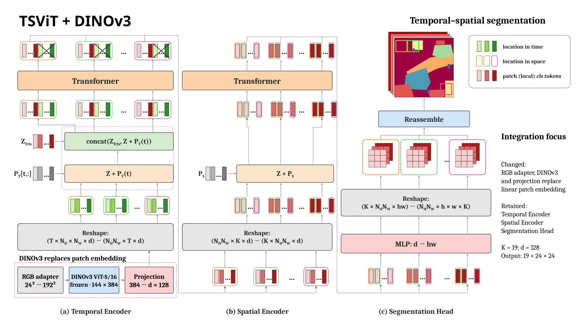
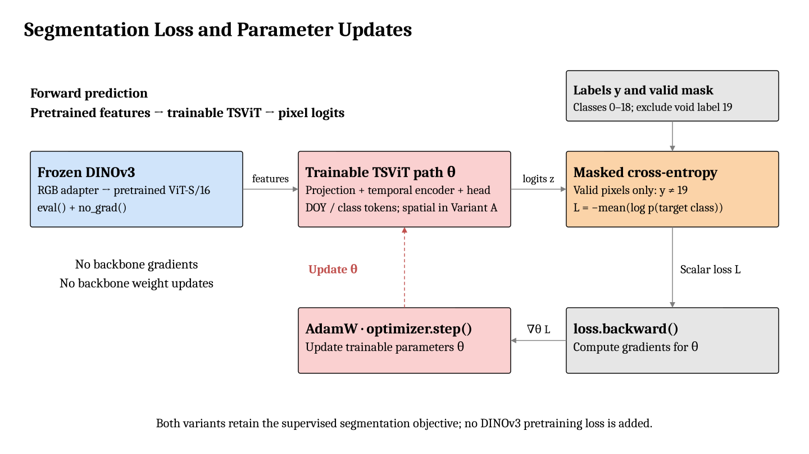

# TSViT + DINOv3 for Satellite Time-Series Segmentation

This project integrates a **pretrained, frozen DINOv3 image backbone** into TSViT for pixel-wise land-cover/crop-type prediction from satellite image time series. It builds on [DeepSatModels](https://github.com/michaeltrs/DeepSatModels) at commit `53e6559`.

**Status: integration in progress.** The current goal is to load the pretrained backbone and verify the complete forward → segmentation loss → backward → optimizer-step → checkpoint path on one real PASTIS24 sample. Full-dataset training and held-out accuracy comparisons are outside this verification scope.

The DINOv3 work lives on **`feat/dinov3-integration`**. `main` retains the upstream baseline until the integration is reviewed and merged.

Contents: [Overview](#project-overview) · [Original model and data](#original-model-and-data) · [DINOv3 integration](#dinov3-integration) · [Training and loss](#training-and-loss) · [Setup](#setup) · [Run and verify](#run-and-verify) · [Verification evidence](#verification) · [Troubleshooting](#troubleshooting) · [Limitations](#limitations) · [References](#references)

<a id="project-overview"></a>

## 1. Project Overview

| Item | Current scope |
| --- | --- |
| Task | Semantic segmentation of satellite image time series |
| Intended readers | Students, researchers and reviewers reproducing the integration |
| Dataset interface | PASTIS24 pickle samples and path CSVs |
| Model input | Ten spectral bands plus acquisition day of year (DOY) |
| Prediction | Nineteen class logits per pixel on a 24 × 24 grid |
| Supervision | Labels 0–18; void label 19 excluded by a valid-pixel mask |
| Verified backbone | DINOv3 ViT-S/16, pretrained on LVD-1689M |
| Acceptance criterion | Executable integration with correct tensor layout, loss, gradients, weight updates and save/load |

A one-step smoke check verifies the implementation. It does not train a useful crop mapper or establish an accuracy improvement.

The two implementation questions addressed here are:

1. **How is DINOv3 integrated?** Replace TSViT's linear patch embedding with an RGB adapter, a frozen pretrained backbone and a trainable feature projection. [Section 3](#dinov3-integration) connects this decision to the architecture and code.
2. **How does the integrated model learn?** Retain masked segmentation cross-entropy and update the projection plus the remaining TSViT modules. [Section 4](#training-and-loss) follows the loss calculation, gradients and optimizer step.

<a id="original-model-and-data"></a>

## 2. Original TSViT and Data Pipeline

### 2.1 Original paper architecture



*Figure 1. Original TSViT architecture, including its segmentation and classification paths. This integration uses semantic segmentation.*

TSViT divides each date's ten-band image into 2 × 2 patches. A learned linear map embeds the 40 values in each patch into 128 features. DOY embeddings are added before temporal attention, and K = 19 learned class tokens are prepended to each spatial location's date sequence. The temporal encoder's class-token outputs are reshaped for class-specific spatial attention. A LayerNorm + Linear head predicts four pixel logits per class/patch, then reconstructs the 24 × 24 map.

### 2.2 Original data overview



*Figure 2. Original data pipeline. The current smoke check starts from an existing PASTIS24 pickle; acquisition, resampling and label rasterization precede this reproduction.*

The data overview uses channel-first notation. The actual [`PASTIS_segmentation_transform`](data/PASTIS24/data_transforms.py) finishes by converting images to channel-last layout before the model is called:

| Stage | Tensor / contents |
| --- | --- |
| Stored sample | `img: [T,10,24,24]`, `doy: [T]`, `labels: [L,24,24]` |
| Preprocessing | Normalize ten bands → append DOY → cut/pad to T′ = 60 → construct void mask |
| Model input | `[B,T′,24,24,11]`; last channel is DOY |
| Ground truth | `[B,24,24,1]`; the loader uses `labels[0]` |
| Valid mask | `[B,24,24,1]`, equal to `labels != 19` |
| Model logits | `[B,19,24,24]`; training permutes this to `[B,24,24,19]` for the criterion |

<a id="dinov3-integration"></a>
<a id="implementation-highlights--key-code-changes"></a>

## 3. DINOv3 Integration: Why, Where and How

**Integration decision:** use DINOv3 to extract pretrained spatial features from each acquisition date, project those features into TSViT's embedding space, and retain TSViT's temporal modeling. Variant A is the main walkthrough below; Variant B additionally removes post-temporal spatial attention.

### 3.1 Why introduce a pretrained image backbone?

In the baseline, each 2 × 2 patch contains 40 values from ten spectral bands. A learned `Linear(40,128)` turns that patch into a token. This input path has no pretrained image backbone: its projection is learned through the supervised segmentation task.

The integration investigates a different source of input features: DINOv3 processes the RGB image at each date and supplies spatial patch representations learned during pretraining. TSViT then models how these representations change over time. Freezing the backbone lets this project optimize the projection and TSViT modules while keeping the pretrained image weights fixed.

The question for future evaluation is whether these pretrained features help crop segmentation. The current executable check establishes integration correctness. The main tradeoff is that the adapter uses only RGB, leaving seven spectral bands unused; resizing also adds backbone computation without adding image detail.

### 3.2 Variant A: replace patch embedding, retain both encoders

The changed module is **`to_patch_embedding`**, before temporal attention:

```text
Original embedding:  ten-band patches → Linear(40,128)
Variant A embedding: RGB preparation → frozen DINOv3 → Linear(384,128)

Shared downstream path: DOY + class tokens → Temporal → Spatial → Head
```



*Figure 3. `TSViT_DINOv3`: the added patch-embedding path is outlined below the Temporal Encoder. The original temporal/spatial token notation and segmentation head are retained. Classification-only spatial global tokens and the classification head are omitted because this implementation performs segmentation.*

[`TSViTDINOv3`](models/TSViT/TSViTDINOv3.py#L97) implements the replacement by subclassing the original model:

```python
class TSViTDINOv3(TSViT):
    def __init__(self, model_config):
        super().__init__(model_config)
        self.to_patch_embedding = DINOv3PatchEmbedding(model_config)
```

The class inherits [`TSViT.forward()`](models/TSViT/TSViTdense.py#L419). That forward still separates DOY, adds its embedding, prepends temporal class tokens, runs temporal and spatial attention, and reconstructs `[B,19,24,24]` pixel logits. Supplying the same patch-token interface makes those downstream operations reusable.

### 3.3 Where DINOv3 comes from and how code loads it

The verified checkpoint is Meta's [facebook/dinov3-vits16-pretrain-lvd1689m](https://huggingface.co/facebook/dinov3-vits16-pretrain-lvd1689m), revision `114c1379950215c8b35dfcd4e90a5c251dde0d32`. This is the web-pretrained Small model. Its origin, revision and file SHA256 are recorded in [checkpoint provenance](docs/validation/final-task1/provenance.json); satellite-pretrained checkpoints have not been verified here.

[`models.get_model()`](models/__init__.py) maps `MODEL.architecture: TSViT_DINOv3` to `TSViTDINOv3`. The adapter reads `MODEL.dinov3_checkpoint` from YAML. The relevant fields in a complete [smoke configuration](configs/PASTIS24/TSViT_DINOv3_small_smoke.yaml) are:

```yaml
MODEL:
  architecture: TSViT_DINOv3
  dinov3_checkpoint: /absolute/path/to/dinov3-small
  dim: 128
  frame_chunk_size: 1
```

Excerpt from [`DINOv3PatchEmbedding.__init__()`](models/TSViT/TSViTDINOv3.py#L24):

```python
checkpoint = Path(model_config['dinov3_checkpoint']).expanduser()
self.backbone = AutoModel.from_pretrained(str(checkpoint), local_files_only=True)
self.backbone.requires_grad_(False)
self.backbone.eval()
self.projection = nn.Linear(self.backbone.config.hidden_size, model_config['dim'])
```

The checkpoint supplies the backbone weights and its hidden size, which is 384 for the verified Small model. The new projection maps 384 → 128 and is learned during supervised training. A `train()` override keeps the backbone in `eval()` after `net.train()`; feature extraction also uses `torch.no_grad()`, as shown below. The projection stays outside that context so it receives gradients.

The loader reads local files. [Setup](#setup) covers dependencies, checkpoint access/download and configuration paths; model construction does not download weights automatically.

### 3.4 Input adapter and tensor interfaces

Both variants share the same bridge from satellite images to TSViT's temporal input:

| Stage | Operation and output |
| --- | --- |
| RGB preparation | Select B04/B03/B02 (`[2,1,0]`), reverse PASTIS normalization, scale reflectance, resize 24 × 24 → 192 × 192, then apply the checkpoint's mean/std |
| Frozen DINOv3 | Process valid dates and retain 144 spatial patch tokens of dimension 384; discard CLS/register tokens |
| Trainable projection | Restore batch/time positions, apply `Linear(384,128)` and rearrange to `[B·144,T,128]` |

DOY follows the original temporal embedding. The [detailed adapter walkthrough](README_DINOV3.md#input-adaptation) shows the normalization formula, token selection and intermediate tensor layouts.

**RGB preparation in code.** [`prepare_rgb()`](models/TSViT/TSViTDINOv3.py#L65) reverses the dataset's normalization before applying the pretrained checkpoint's normalization:

```python
rgb = frames.index_select(1, self.rgb_indices)  # B04/B03/B02: [2,1,0]
rgb = (rgb * self.pastis_std + self.pastis_mean) / 10000.0
rgb = rgb.clamp(0, 1)
rgb = F.interpolate(rgb, size=(self.dino_image_size, self.dino_image_size),
                    mode='bilinear', align_corners=False, antialias=True)
return (rgb - self.dino_mean) / self.dino_std
```

The grid aligns because `192 / 16 = 24 / 2 = 12` patches per axis. Upsampling supplies the backbone's input size; it adds no image detail and does not resize labels. The other seven spectral bands are currently unused for image features.

**Frozen features and trainable projection in code.** Inside [`DINOv3PatchEmbedding.forward()`](models/TSViT/TSViTDINOv3.py#L73), normalized input is flattened to `B·T` frames. `valid_indices` selects non-padded dates. The excerpt below omits input/token-count guards and retains the chunking, token selection and gradient boundary:

```python
with torch.no_grad():
    features = frames.new_zeros((b * t, num_patches, self.backbone.config.hidden_size))
    for start in range(0, valid_indices.numel(), self.frame_chunk_size):
        indices = valid_indices[start:start + self.frame_chunk_size]
        rgb = self.prepare_rgb(frames.index_select(0, indices))
        tokens = self.backbone(pixel_values=rgb).last_hidden_state
        patch_tokens = tokens[:, 1 + self.backbone.config.num_register_tokens:]
        features.index_copy_(0, indices, patch_tokens.to(features.dtype))

embeddings = self.projection(features)  # Trainable: outside no_grad().
return rearrange(embeddings.reshape(b, t, num_patches, -1),
                 'b t n d -> (b n) t d')
```

Keeping only patch tokens preserves spatial locations; scattering restores each date's batch/time position. The final rearrangement groups all dates of a given spatial patch together, producing `[B·144,T,128]` for TSViT's temporal encoder.

Padding retains the original temporal policy: padded features become the projection's bias after the linear map, and DOY = 0 still receives a temporal embedding. No new temporal attention mask is introduced. See [implementation notes](README_DINOV3.md#padding-and-attention) for the exact behavior.

### 3.5 Variant B: additionally remove post-temporal spatial attention

`TSViT_DINOv3_Temporal` selects [`TSViTDINOv3Temporal`](models/TSViT/TSViTDINOv3.py#L109). Its initializer reuses the adapter and temporal blocks while removing the spatial modules:

```python
super().__init__({**model_config, 'spatial_depth': 0})
del self.space_transformer
del self.space_pos_embedding
```

Its dedicated forward regroups temporal class-token outputs from `[B,N,K,d]` to `[B,K,N,d]`, applies embedding dropout and sends them to the segmentation head. See the [temporal-only architecture](README_DINOV3.md#temporal-only-variant) for the complete diagram.

DINOv3 mixes spatial information within each date before temporal aggregation. The removed TSViT spatial encoder would have mixed patches after temporal aggregation. These operations occur at different stages. Both variants execute successfully; their predictive quality has not been compared.

<a id="what-changed"></a>

### 3.6 Component changes and the code path to follow

| Component | Original TSViT | `TSViT_DINOv3` | `TSViT_DINOv3_Temporal` |
| --- | --- | --- | --- |
| Image embedding | Linear map of ten-band patches | RGB adapter → frozen DINOv3 → trainable projection | Same adapter |
| DOY embedding / temporal class tokens | Trainable | Retained | Retained |
| Temporal Transformer | Trainable | Retained | Retained |
| Spatial Transformer / spatial positions | Trainable | Retained | Removed |
| Segmentation head / pixel reconstruction | LayerNorm → Linear → rearrange | Retained | Retained |
| Output / segmentation objective | Nineteen-class logits / masked cross-entropy | Retained | Retained |

| Code | Responsibility |
| --- | --- |
| [`configs/PASTIS24/`](configs/PASTIS24/) → [`models/__init__.py`](models/__init__.py) | YAML selects the architecture; `get_model()` constructs its class |
| [`models/TSViT/TSViTDINOv3.py`](models/TSViT/TSViTDINOv3.py) | `prepare_rgb()` adapts images; `DINOv3PatchEmbedding.forward()` extracts/projects tokens; the two model classes define the integration |
| [`models/TSViT/TSViTdense.py`](models/TSViT/TSViTdense.py) | `TSViT.forward()` supplies Variant A's retained temporal/spatial/head path |
| [`data/__init__.py`](data/__init__.py) → [`metrics/loss_functions.py`](metrics/loss_functions.py) | `get_loss_data_input()` supplies labels/mask; `get_loss()` selects `MaskedCrossEntropyLoss` |
| [`utils/torch_utils.py`](utils/torch_utils.py) → [`train_and_eval/segmentation_training_transf.py`](train_and_eval/segmentation_training_transf.py) | Select trainable parameters, construct AdamW, execute `train_step()` and save weights |
| [`tests/smoke_dinov3.py`](tests/smoke_dinov3.py) | Check the actual input/feature layout, loss, gradients, updates and checkpoint round trip |

Additional loader/config compatibility changes and their rationale are indexed in [README_DINOV3.md](README_DINOV3.md#2-code-changes-and-rationale).

<a id="training-and-loss"></a>

## 4. Training Objective and Parameter Updates

**Training decision:** keep supervised masked cross-entropy because the prediction target is still the same nineteen-class segmentation map. DINOv3 supplies fixed pretrained features; the projection and remaining TSViT modules learn from the segmentation loss. No DINOv3 pretraining loss is added.



*Figure 4. Both variants use the same supervised segmentation objective. The dashed return arrow marks the parameter update to the trainable TSViT path; DINOv3 remains frozen.*

### 4.1 What the model is trained to predict

For each pixel, the model emits nineteen unnormalized class scores, or logits. The ground-truth class is in 0–18. Masked cross-entropy penalizes assigning low probability to that class and averages the penalty over valid pixels. Void label 19 is excluded before computing the loss.

The input feature extractor has changed, while the label space and pixel-level prediction target are retained. This is why the original segmentation objective remains appropriate. For pixel logits `z`, labels `y` and valid pixels `V`:

$$
V=\{i\mid y_i\neq19\},\qquad |V|>0,
$$

$$
\mathcal{L}=-\frac{1}{\lvert V\rvert}\sum_{i\in V}
\log\left(\frac{\exp(z_{i,y_i})}{\sum_{c=0}^{18}\exp(z_{i,c})}\right).
$$

Here `i` identifies a pixel across the batch, `y_i` is its true class, and `z_{i,c}` is its logit for class `c`. For example, a valid pixel labeled 3 contributes `−log p(class=3)`; a pixel labeled 19 contributes no loss or logit gradient.

### 4.2 How the configured loss is implemented

`SOLVER.loss_function: masked_cross_entropy` selects [`MaskedCrossEntropyLoss`](metrics/loss_functions.py#L141) through `get_loss()`. The data transform creates `unk_masks = (labels != 19)`, and [`get_loss_data_input()`](data/__init__.py#L91) passes `(labels, unk_masks)` to the criterion. The entrypoint permutes logits from `[B,19,24,24]` to `[B,24,24,19]`, putting the class axis last.

For the configured mean loss, the implementation is equivalent to this calculation. This shortened form makes valid-pixel selection, class normalization and averaging explicit:

```python
target, mask = ground_truth                              # Both [B,H,W,1].
valid = mask.squeeze(-1)
z_valid = logits[valid]                                  # [M,19] valid pixels.
y_valid = target.squeeze(-1)[valid].long()                # [M] labels, 0–18.
if y_valid.numel() == 0:
    raise ValueError('no valid target pixels for mean reduction')
log_probs = torch.nn.functional.log_softmax(z_valid, dim=-1)
loss = -log_probs.gather(1, y_valid[:, None]).mean()
```

`log_softmax` normalizes over classes; `gather` selects the true class at each valid pixel. Raw logits go into the criterion, which performs its own normalization. The source also supports unmasked targets and unreduced per-pixel loss.

An all-void mean raises `ValueError` before `backward()` or `optimizer.step()`. Automatic skipping is not implemented. The unreduced evaluation output remains empty for an all-void sample.

### 4.3 How backward and AdamW update the integrated model

The initialization code in [`train_and_evaluate()`](train_and_eval/segmentation_training_transf.py#L26) connects the YAML-selected criterion, ground-truth adapter and optimizer:

```python
loss_input_fn = get_loss_data_input(config)
loss_fn = {'all': get_loss(config, device, reduction=None),
           'mean': get_loss(config, device, reduction="mean")}
trainable_params = get_net_trainable_params(net)
optimizer = optim.AdamW(trainable_params, lr=lr, weight_decay=weight_decay)
```

For the DINOv3 models, `get_net_trainable_params()` uses their `trainable_params` property, which filters parameters by `requires_grad`. The actual [`train_step()`](train_and_eval/segmentation_training_transf.py#L34) then runs the following sequence; only comments are shortened here:

```python
def train_step(net, sample, loss_fn, optimizer, device, loss_input_fn):
    optimizer.zero_grad()
    outputs = net(sample['inputs'].to(device))           # [B,19,24,24]
    outputs = outputs.permute(0, 2, 3, 1)                # [B,24,24,19]
    ground_truth = loss_input_fn(sample, device)         # Labels and mask.
    loss = loss_fn['mean'](outputs, ground_truth)
    loss.backward()                                    # Compute gradients.
    optimizer.step()                                   # Update parameters.
    return outputs, ground_truth, loss
```

The segmentation loss produces gradients for the projection, DOY embeddings, class tokens, encoders and head. The projection remains trainable even though its input features were extracted under `no_grad()`. DINOv3 has `requires_grad=False`, and its feature extraction is outside the gradient graph, so its pretrained weights stay fixed. `MaskedCrossEntropyLoss` has no learnable parameters.

| Component | Learnable here? | Gradient / update in the one-step check |
| --- | --- | --- |
| RGB preparation | Fixed operations and buffers | No parameter updates |
| DINOv3 backbone | Frozen | No gradients; weights match the pretrained state after the step |
| Projection `384 → 128` | Yes | Finite nonzero gradients; weights change after the step |
| DOY embedding and temporal class tokens | Yes | Gradients and updates verified |
| Temporal Transformer | Yes | Gradients and updates verified |
| Spatial Transformer and spatial positions | Variant A only | Gradients and updates verified when present |
| Segmentation head | Yes | Gradients and updates verified |
| Loss function | No learnable parameters | Computes the scalar objective |

The checked optimizer is AdamW over the model's trainable parameters, with `lr=1e-3` and `weight_decay=0` in the smoke YAMLs. These settings exercise one optimizer step; they are not a tuned full-training recipe. The standard entrypoint also has its original scheduler and save/evaluation loop, but its smoke configuration contains just one training batch and one evaluation batch of the same sample.

The [one-step verification](docs/integration-verification.md) checks this code path directly: loss/logit gradients match valid-pixel cross-entropy, trainable tensors change after AdamW, frozen backbone tensors stay unchanged, and saved weights reproduce the output after loading. [Run and verify](#run-and-verify) gives the commands without requiring full-dataset training.

<a id="setup"></a>
<a id="installation"></a>

## 5. Environment, Setup and Configuration

All commands below run from the **repository root** in a Linux shell. Install [uv](https://docs.astral.sh/uv/getting-started/installation/) if it is not already available.

### 5.1 Tested environment

| Item | Verified environment |
| --- | --- |
| OS | Ubuntu 24.04.5 LTS |
| Python | 3.13.14 |
| PyTorch / torchvision | 2.9.1+cu128 / 0.24.1 |
| Transformers / timm | 4.57.6 / 1.0.19 |
| GPU | NVIDIA GeForce RTX 3050 Laptop GPU |
| Required external files | Local DINOv3 checkpoint and the PASTIS24 smoke pickle |

CUDA is required by the current GPU smoke check and training entrypoint. The loss unit tests run on CPU and need no dataset or pretrained weights. Package versions from the earlier verified environment are also recorded in [environment-freeze.txt](docs/validation/environment-freeze.txt).

### 5.2 Clone and install

```bash
git clone --branch feat/dinov3-integration https://github.com/loanhviet/DeepSatModels-DINOv3.git
cd DeepSatModels-DINOv3
uv venv --python 3.13 .venv
uv pip install --python .venv/bin/python torch==2.9.1 torchvision==0.24.1 \
  --index-url https://download.pytorch.org/whl/cu128
uv pip install --python .venv/bin/python -r requirements-dinov3.txt
```

Check the installation:

```bash
.venv/bin/python -c "import torch, transformers; print(torch.__version__, transformers.__version__); print('CUDA:', torch.cuda.is_available())"
```

Expected: `2.9.1+cu128 4.57.6` and `CUDA: True` on the verified GPU setup. If CUDA is false, CPU loss tests are still available; resolve the GPU environment before running GPU commands.

### 5.3 Prepare the pretrained checkpoint

Obtain access on the [official model page](https://huggingface.co/facebook/dinov3-vits16-pretrain-lvd1689m), then download these files to a local directory. If the checkpoint is already present, reuse it.

```bash
.venv/bin/hf auth login
.venv/bin/hf download facebook/dinov3-vits16-pretrain-lvd1689m \
  config.json model.safetensors preprocessor_config.json \
  --revision 114c1379950215c8b35dfcd4e90a5c251dde0d32 \
  --local-dir /absolute/path/to/dinov3-small
```

Expected directory:

```text
dinov3-small/
├── config.json
├── model.safetensors
└── preprocessor_config.json
```

The model is loaded from this directory through `AutoModel`; the `.safetensors` file is not a TSViT `.pth` checkpoint. Authenticate through the CLI prompt; no token belongs in YAML or Git.

### 5.4 Prepare the real sample and local smoke configs

Prepare `10000_0.pickle` from the existing [PASTIS24 data](https://drive.google.com/drive/u/0/folders/1-ymz_s6-3BCUcLqNDJ67VKiSTx2n4Glw). It is not bundled in this repository. The verified fixture has 43 real dates, is padded to 60, and has 521 valid pixels plus 55 void pixels. The dedicated smoke test contains checks for this fixture's layout and padding.

[`tests/fixtures/pastis24-smoke.csv`](tests/fixtures/pastis24-smoke.csv) contains the single filename `10000_0.pickle`. Therefore `base_dir` must be the directory containing that file directly. The smoke intentionally uses the same sample for train/eval to check mechanics; this is not an independent validation split.

Create local YAML copies under the ignored `outputs/` directory. Replace the two paths below before running:

```bash
.venv/bin/python - <<'PY'
from pathlib import Path
import yaml

checkpoint = Path('/absolute/path/to/dinov3-small').expanduser().resolve()
sample_root = Path('/absolute/path/to/folder-containing-10000_0.pickle').expanduser().resolve()
for filename in ('config.json', 'model.safetensors', 'preprocessor_config.json'):
    assert (checkpoint / filename).is_file(), f'Missing checkpoint file: {filename}'
assert (sample_root / '10000_0.pickle').is_file(), 'Missing smoke sample'
out = Path('outputs/local-smoke')
out.mkdir(parents=True, exist_ok=True)
for name in ('TSViT_DINOv3_small_smoke', 'TSViT_DINOv3_Temporal_small_smoke'):
    config = yaml.safe_load(Path(f'configs/PASTIS24/{name}.yaml').read_text())
    config['MODEL']['dinov3_checkpoint'] = str(checkpoint)
    for split in ('train', 'eval'):
        config['DATASETS'][split]['base_dir'] = str(sample_root)
        config['DATASETS'][split]['paths'] = 'tests/fixtures/pastis24-smoke.csv'
    config['CHECKPOINT']['save_path'] = str(out / f'{name}-entrypoint')
    path = out / f'{name}.yaml'
    path.write_text(yaml.safe_dump(config, sort_keys=False))
    print(path)
PY
```

Expected: two printed YAML paths under `outputs/local-smoke/`. This keeps machine-specific paths in local copies instead of changing shared configs.

| YAML field | Meaning |
| --- | --- |
| `MODEL.architecture` | `TSViT_DINOv3` or `TSViT_DINOv3_Temporal` |
| `MODEL.dinov3_checkpoint` | Local Hugging Face checkpoint directory |
| `MODEL.frame_chunk_size` | Valid frames processed by DINOv3 per chunk; verified value is 1 |
| `DATASETS.train/eval.base_dir` | Root joined with every CSV entry |
| `DATASETS.train/eval.paths` | One-column, headerless sample-path CSV |
| `SOLVER.seed`, `lr_base`, `weight_decay` | Reproducibility and one-step optimizer settings |
| `CHECKPOINT.save_path` | Directory for entrypoint logs and weight files |
| `CHECKPOINT.load_from_checkpoint` | Empty for the smoke; loads model weights only when supplied |

<a id="run-and-verify"></a>

## 6. Run, Verify and Use the Integration

### 6.1 CPU loss regression checks

```bash
.venv/bin/python -m unittest discover -s tests -p 'test_masked_cross_entropy.py' -v
```

Expected: **4 tests, OK**. These cover valid-pixel loss/gradient equivalence, no-mask behavior and all-void handling.

### 6.2 One-sample GPU smoke checks

After creating the local YAMLs in section 5.4:

```bash
.venv/bin/python tests/smoke_dinov3.py \
  --config outputs/local-smoke/TSViT_DINOv3_small_smoke.yaml \
  --output outputs/local-smoke/dinov3
.venv/bin/python tests/smoke_dinov3.py \
  --config outputs/local-smoke/TSViT_DINOv3_Temporal_small_smoke.yaml \
  --output outputs/local-smoke/temporal
```

Expected: exit code 0 and, for each variant, `result.json` plus `roundtrip.pth` in its output directory. The report should show:

```json
{
  "logits_shape": [1, 19, 24, 24],
  "loss_and_logits_gradient_match_valid_pixel_cross_entropy": true,
  "weights_unchanged_after_backward_before_step": true,
  "void_logits_gradient_max_abs": 0.0,
  "backbone_unchanged": true,
  "checkpoint_roundtrip_exact": true
}
```

This is an excerpt of the expected report fields. The complete report also records finite loss, parameter-group gradients and updates, optimizer coverage, RGB adaptation, batch/time/patch ordering, source/checkpoint hashes and memory diagnostics. It includes a lightweight original-TSViT regression pass and extra forward/save-load checks, but only one optimizer step for the DINOv3 model.

### 6.3 Run the standard training entrypoint for one step

To check the repository's normal training/evaluation loop using the same one-sample smoke configuration:

```bash
.venv/bin/python train_and_eval/segmentation_training_transf.py \
  --config outputs/local-smoke/TSViT_DINOv3_small_smoke.yaml --device 0
.venv/bin/python train_and_eval/segmentation_training_transf.py \
  --config outputs/local-smoke/TSViT_DINOv3_Temporal_small_smoke.yaml --device 0
```

Expected: one training batch and one evaluation batch, `config_file.yaml`, `1epoch_1step.pth`, TensorBoard events and `cuda_memory.json` under each configured `CHECKPOINT.save_path`. `best.pth` is written only if the measured IoU exceeds the loop's initial best value. Same-sample metrics here are execution diagnostics.

The correct flags for this script are `--config` and `--device`. Fold-training YAMLs are future starting points and are not part of the commands above. Checkpoint loading restores weights, not the optimizer/scheduler state or epoch; it is not a full training resume.

### 6.4 Read the verification evidence

Open `result.json` to inspect integration checks, `gradient_l2`, `parameter_updates`, the frozen-backbone state and checkpoint round-trip results. The [verification record](docs/integration-verification.md) links the recorded reports and explains their scope.

<a id="verification"></a>

## 7. Integration Verification Evidence

The [current verification record](docs/integration-verification.md) documents the one-sample checks, commands, environment and reproducible report files. Earlier reports are retained under [`docs/validation/final-task1/`](docs/validation/final-task1/).

| Acceptance check | Variant A: temporal + spatial | Variant B: temporal only |
| --- | --- | --- |
| Logits `[1,19,24,24]` and finite loss | Passed | Passed |
| Valid-pixel loss and gradients match cross-entropy | Passed | Passed |
| Void-pixel logit gradients are zero | Passed | Passed |
| Finite, nonzero gradients on trainable groups | Passed | Passed |
| AdamW covers trainable tensors without duplicates | 102 / 102 | 55 / 55 |
| Weights change after the optimizer step | Passed | Passed |
| Frozen DINOv3 state stays unchanged | Passed | Passed |
| Checkpoint round trip matches exactly | Passed | Passed |

These checks establish execution and parameter updates. No full training, held-out accuracy/mIoU comparison or claim of improved predictions is included.

<a id="troubleshooting"></a>

## 8. Troubleshooting

| Symptom | Check / action |
| --- | --- |
| Missing `torch`, `transformers`, `yaml` or another package | Run the install commands with `--python .venv/bin/python`; use that same interpreter to execute scripts. |
| Hugging Face download denied | Obtain access on the official model page and authenticate through `hf auth login`. |
| Local DINOv3 checkpoint not found | Point `MODEL.dinov3_checkpoint` at the directory containing all three checkpoint files. |
| CSV / pickle not found | Check the path produced by `base_dir` + CSV entry. The smoke fixture expects `10000_0.pickle` directly under `base_dir`. |
| CUDA unavailable / no allowed device | Check the driver, CUDA-enabled torch installation and selected interpreter. The current entrypoint requires CUDA. |
| Out of memory | Return to the verified Small checkpoint, batch size 1 and `frame_chunk_size=1`; close other GPU workloads. |
| Smoke padding/layout assertion fails on another sample | Use the verified fixture and T = 60. The dedicated smoke has fixture-specific assertions. |
| Missing/unexpected state-dict keys | Match the architecture to its checkpoint. The variants and original TSViT have different parameter sets. |
| `no valid target pixels for mean reduction` | The batch has no valid labels. Mean loss deliberately raises; automatic batch skipping is not implemented. |
| Cosine schedule warning on a one-step run | The smoke contains only one step; it does not exercise a meaningful annealing interval. |

<a id="limitations"></a>

## 9. Limitations and Next Steps

- RGB-only adaptation currently leaves seven spectral bands unused; resizing does not recover spatial information.
- Temporal padding participates in attention as in the original implementation; there is no new temporal mask.
- Only the frozen Small checkpoint and single-GPU execution have been verified. Fine-tuning, Base/Satellite checkpoints and multi-GPU runs remain unverified.
- A fully void evaluation split has undefined aggregate metrics. An all-void training batch raises an error.
- Prediction quality, full-data training, baseline comparisons and ablations are future work. They are not required to reproduce the current integration checks.

<a id="references"></a>

## 10. References, License and Maintenance

- [ViTs for SITS: Vision Transformers for Satellite Image Time Series](https://arxiv.org/abs/2301.04944), [upstream DeepSatModels](https://github.com/michaeltrs/DeepSatModels), and [original TSViT documentation](README_TSVIT.md).
- [DINOv3 paper](https://arxiv.org/abs/2508.10104), [official repository](https://github.com/facebookresearch/dinov3), and [verified ViT-S/16 checkpoint](https://huggingface.co/facebook/dinov3-vits16-pretrain-lvd1689m).
- [PASTIS benchmark](https://github.com/VSainteuf/pastis-benchmark), including the [RGB band-order example](https://github.com/VSainteuf/pastis-benchmark/blob/main/demo.ipynb).

Maintainer: [Lo Anh Viet](https://github.com/loanhviet). Code follows [Apache 2.0](LICENSE.txt); pretrained weights follow their own DINOv3 license. Original code copyright © 2023 Michail Tarasiou.
