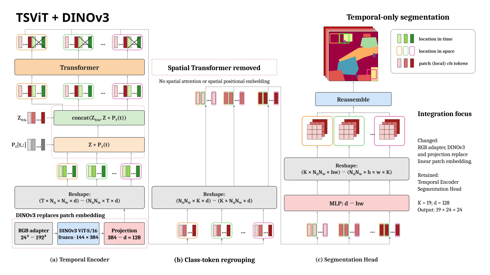
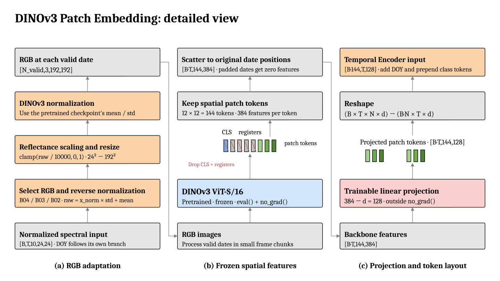

# DINOv3 Integration with TSViT

This is the implementation companion to the [main README](README.md).
For the insertion point and component comparison, see [DINOv3 integration](README.md#dinov3-integration).
The main walkthrough includes [RGB/token adapter code](README.md#34-input-adapter-and-tensor-interfaces),
the [masked-loss calculation](README.md#42-how-the-configured-loss-is-implemented)
and the [training step and optimizer](README.md#43-how-backward-and-adamw-update-the-integrated-model).

This guide documents changes from DeepSatModels at commit `53e6559` and
explains how to reproduce the validation runs. The supported configuration
is semantic segmentation on PASTIS24, producing a 24×24 output map with
19 classes.

Local smoke checks verify the implementation on a small real sample. Full
training and evaluation on separate splits have not been performed.
The acceptance target is executable integration, including a finite loss,
backward, one optimizer step and checkpoint save/load. Full training is future work.

## 1. Architecture

```text
Original TSViT:
Images → Patch embedding → Temporal Transformer → Spatial Transformer → Head

TSViT_DINOv3:
Images → RGB adapter → DINOv3 → Projection
       → Temporal Transformer → Spatial Transformer → Head

TSViT_DINOv3_Temporal:
Images → RGB adapter → DINOv3 → Projection → Temporal Transformer → Head
```

| Component | `TSViT_DINOv3` | `TSViT_DINOv3_Temporal` |
| --- | --- | --- |
| DINOv3 | Frozen, always in `eval()` mode | Same |
| Projection | Trainable | Trainable |
| DOY embedding and class tokens | Original structure, trainable | Same |
| Temporal Transformer | Original attention, trainable | Same |
| TSViT spatial Transformer and spatial positional embedding | Retained and trainable | Removed |
| Segmentation head and patch reconstruction | Original structure, trainable | Same |
| Loss | Original masked cross-entropy | Same |

Freezing means DINOv3 weights are not updated during training. The backbone
runs inside `torch.no_grad()`, while the projection and remaining TSViT
blocks receive gradients. With `frame_chunk_size=1`, one image is passed
through DINOv3 at a time to limit memory use.

`TSViT_DINOv3` replaces only `to_patch_embedding` and inherits
`TSViT.forward()`. Its [architecture diagram](README.md#32-variant-a-replace-patch-embedding-retain-both-encoders) is in the main README.

### Temporal-only variant



*The temporal-only architecture retains the original token notation and segmentation head. Spatial attention and spatial positional embeddings are removed; class-token regrouping is still required.*

`TSViT_DINOv3_Temporal` uses a separate forward pass that
connects temporal outputs directly to the head; it has no `space_*` modules
or weights. It combines a DINOv3 spatial encoder with the TSViT temporal
encoder. DINOv3 processes each image before temporal aggregation. Further
experiments are needed to assess the effect of removing the spatial
Transformer that originally followed temporal aggregation.

### Input adaptation



*Read (a) bottom to top, then (b), then (c). The columns show RGB preparation, frozen spatial features and the trainable projection into the temporal encoder.*

The original PASTIS transform returns `[B,T,24,24,11]`: ten normalized
spectral bands and one day-of-year (DOY) channel. DOY is still passed to the
original temporal embedding. The image adapter:

1. Selects B04/B03/B02 as RGB, using indices `[2,1,0]` in PASTIS band order.
2. Reverses normalization with `raw = normalized * std + mean`, using the
   exact statistics from the original `Normalize` transform.
3. Computes `rgb = clamp(raw / 10000, 0, 1)`, resizes bilinearly from 24×24
   to 192×192, and applies the checkpoint's DINOv3 normalization statistics.
4. Runs frozen DINOv3 on valid dates in frame chunks, under `eval()` and
   `torch.no_grad()`. With Small, it retains 144 patch tokens of dimension
   384 per date, excluding CLS and register tokens.
5. Scatters tokens back to their original batch/time positions in
   `[B·T,144,384]`. Padded dates have zero features before projection.
6. Projects Small's 384-dimensional features to TSViT's 128-dimensional
   space with `Linear(384,128)`, outside `torch.no_grad()`.
7. Rearranges `[B,T,144,128]` to `[B·144,T,128]` for temporal attention.
   TSViT then adds DOY embeddings and prepends its learned class tokens.

The grids align because `192 / 16 = 24 / 2 = 12` patches per axis, yielding
144 spatial locations in both the original model and the adapter.

The current implementation uses RGB only; the other seven bands are not
used for feature extraction. Resizing is confined to the adapter, adds no
new image detail, and does not resize labels. Output logits have shape
`[B,19,24,24]`; the original entrypoint rearranges them for the loss.
Classes 0–18 are included in training, while void label 19 is excluded by
the label mask. The valid-pixel loss objective remains unchanged because the prediction format,
labels, and segmentation objective are unchanged.

### Padding and attention

The original transform normalizes observations before padding entire
frames, including DOY, with zeros. The adapter detects frames whose ten
normalized bands are all zero, skips DINOv3 for them, and sets their
features to zero before projection:

```text
Projected embedding of a padded frame = Linear(0) = projection.bias
Temporal input = projection.bias + temporal_embedding(one_hot(DOY=0))
```

Embeddings are not zeroed again after projection. Temporal attention still
includes padded positions, as in the original TSViT. `seq_lengths` is not
used to introduce an attention mask. Both variants use this padding policy.

## 2. Code changes and rationale

| File or directory | Change | Reason |
| --- | --- | --- |
| [models/TSViT/TSViTDINOv3.py](models/TSViT/TSViTDINOv3.py) | Adapter and two model classes | Integrate DINOv3 while reusing TSViT blocks |
| [models/__init__.py](models/__init__.py) | Register architectures; import `FCN_CRNN` only when selected | Select models through YAML; avoid requiring `torchfcn` for TSViT |
| [data/__init__.py](data/__init__.py) | Allow paths in experiment configs; import the France loader only when needed | Configure datasets and prevent an indentation error in the original France loader from blocking PASTIS |
| [data/datasets.yaml](data/datasets.yaml) | Remove an extra nesting level in fold1 | Match the loader's expected structure |
| [utils/config_files_utils.py](utils/config_files_utils.py) | Use `safe_load` | Support current PyYAML versions |
| [train_and_eval/segmentation_training_transf.py](train_and_eval/segmentation_training_transf.py) | Optional seed, VRAM reporting, and SummaryWriter cleanup | Reproduce and record runs |
| [configs/PASTIS24](configs/PASTIS24), [requirements-dinov3.txt](requirements-dinov3.txt) | Separate configurations and dependencies | Specify environment, data, checkpoint, and output paths |
| [tests/smoke_dinov3.py](tests/smoke_dinov3.py) | Real-sample, gradient, padding, and save/load checks | Validate the integration |

The original TSViT encoder/attention files, PASTIS loader/transforms, and
metrics are unchanged. The final Task 1 review preserves the valid-pixel loss
formula but adds an empty-mean error and explicit log-softmax class axis.
AdamW, the scheduler, and weight saving continue to use the original pipeline.
Earlier checksums are recorded in [the historical provenance report](docs/validation/provenance.json);
current source hashes and measurements are in [final validation](docs/validation/final-task1/provenance.json).

| Commit | Change |
| --- | --- |
| `af680b7` | Replace patch embedding with DINOv3; retain both TSViT Transformers |
| `532341c` | Add the temporal variant without the TSViT spatial Transformer |

## 3. Environment and checkpoints

The tested Small checkpoint is Meta's
[facebook/dinov3-vits16-pretrain-lvd1689m](https://huggingface.co/facebook/dinov3-vits16-pretrain-lvd1689m),
revision `114c1379950215c8b35dfcd4e90a5c251dde0d32`.
Obtain access through the official Hugging Face page and place the files below
in a local directory. No weights were downloaded during the final review.

From the repository root, create the tested environment:

```bash
uv venv --python 3.13 .venv
uv pip install --python .venv/bin/python torch==2.9.1 torchvision==0.24.1 \
  --index-url https://download.pytorch.org/whl/cu128
uv pip install --python .venv/bin/python -r requirements-dinov3.txt
```

The tested package versions are recorded in
[environment-freeze.txt](docs/validation/environment-freeze.txt).
The training entrypoint requires CUDA; it does not currently allow CPU execution.

`MODEL.dinov3_checkpoint` must point to a Hugging Face checkpoint directory:

```text
small/
├── config.json
├── model.safetensors
└── preprocessor_config.json
```

Download or place checkpoints locally (for example under
`/path/to/dinov3/models/` with `small`, `base`, and `satellite` subdirectories).
Set `MODEL.dinov3_checkpoint` in YAML to the chosen variant directory. The
model loads them with `AutoModel.from_pretrained(..., local_files_only=True)` and
does not automatically download weights. These are not `.pth` files for `torch.hub`.

Small/Base/Satellite have feature dimensions 384/768/1024. The adapter reads
the feature dimension and normalization statistics from the selected
checkpoint. Only Small has been validated. On another machine, update the
YAML paths without editing Python code.

## 4. Data and configuration paths

Data source: [PASTIS24 on Drive](https://drive.google.com/drive/u/0/folders/1-ymz_s6-3BCUcLqNDJ67VKiSTx2n4Glw).
The loader reads pickle files rather than GeoTIFF images. Each sample contains:

| Key | Contents |
| --- | --- |
| `img` | Unnormalized imagery, `[T,10,24,24]` |
| `doy` | Acquisition day of year, `[T]` |
| `labels` | Label planes, `[L,24,24]`; the pipeline uses `labels[0]` |

Path CSVs have one column and no header. The loader joins `base_dir` with
each CSV entry to locate its pickle file. If an entry is
`pickle24x24/10000_0.pickle`, `base_dir` should point to the PASTIS24 root.
The repository's smoke CSV contains only `10000_0.pickle`, so its `base_dir`
must point directly to the directory containing that file.

The dedicated smoke test uses the verified `10000_0.pickle` fixture: 43 real
dates plus 17 padded dates, 521 valid label pixels and 55 void pixels. It
contains fixture-specific padding/layout assertions, so another valid PASTIS24
sample is not necessarily a drop-in replacement. Point
`DATASETS.train/eval.base_dir` at the directory containing this file. Update YAML:

| Field | Required value |
| --- | --- |
| `MODEL.dinov3_checkpoint` | Local DINOv3 checkpoint directory |
| `DATASETS.train/eval.base_dir` | Data root matching the CSV entries |
| `DATASETS.train/eval.paths` | Path CSV for each split |
| `CHECKPOINT.save_path` | Output directory |
| `CHECKPOINT.load_from_checkpoint` | Leave empty for a new training run |

If `base_dir` or `paths` is omitted, the loader falls back to
`data/datasets.yaml`. Run all commands from the repository root so that
relative paths resolve correctly.
The [main setup instructions](README.md#setup) generate local YAML copies
under ignored `outputs/local-smoke/` so that shared configs do not need
machine-specific edits.

## 5. Validation and training

### Local real-sample smoke checks

| Architecture | Smoke configuration |
| --- | --- |
| `TSViT_DINOv3` | `configs/PASTIS24/TSViT_DINOv3_small_smoke.yaml` |
| `TSViT_DINOv3_Temporal` | `configs/PASTIS24/TSViT_DINOv3_Temporal_small_smoke.yaml` |

For the temporal variant, after configuring the paths:

```bash
.venv/bin/python tests/smoke_dinov3.py \
  --config configs/PASTIS24/TSViT_DINOv3_Temporal_small_smoke.yaml
.venv/bin/python train_and_eval/segmentation_training_transf.py \
  --config configs/PASTIS24/TSViT_DINOv3_Temporal_small_smoke.yaml --device 0
```

The first command requires CUDA and a single-sample configuration with batch
size 1 and T=60. Success means exit code 0 and a report at
`outputs/dinov3-temporal-integration/result.json`: logits `[1,19,24,24]`,
finite loss/gradients, an unchanged backbone, and matching save/load outputs.
It also checks RGB preprocessing, token order, and padding.

The second command runs one epoch with one training step and one evaluation
pass through the original entrypoint. The default configuration writes the
run configuration, `1epoch_1step.pth`, `best.pth`, TensorBoard files, and
`cuda_memory.json` to `outputs/dinov3-temporal-smoke-entrypoint/`.
Set `CHECKPOINT.profile_cuda: true` to enable VRAM reporting.

Use the `TSViT_DINOv3` smoke configuration to check the variant retaining
both Transformers. Its default output directories are
`outputs/dinov3-integration/` and `outputs/dinov3-smoke-entrypoint/`.
The `outputs/` directory is excluded from Git.

### Future full training (optional)

This is outside the current acceptance scope. Reproducing the integration
requires only the one-sample checks above and does not require a full run.

The fold1 configurations provide starting points for full training. Before
running, set the data, checkpoint, and output paths as described above, and
verify that the training and evaluation CSVs use the intended separate
splits. The configuration uses 100 epochs, batch size 1, and saves/evaluates
every 2,000 steps. These settings have not been validated on a full run.

For example, with a configured temporal-variant YAML:

```bash
.venv/bin/python train_and_eval/segmentation_training_transf.py \
  --config configs/PASTIS24/TSViT_DINOv3_Temporal_small_fold1.yaml --device 0
```

The command requires a CUDA-enabled environment. Checkpoints must match the
selected architecture. Strict loading across the two variants is unsupported,
and original TSViT checkpoints cannot be loaded directly into the DINOv3
models. The loader restores weights only, not optimizer/scheduler state or
the previous epoch, so loading weights is not a full training resume.

## 6. Local validation status and limitations

See the [current verification record](docs/integration-verification.md)
for refreshed one-step reports and exact commands. The reports linked below
are retained as historical evidence.

| Architecture | Forward/backward and weight update | Original training entrypoint | Checkpoint save/load |
| --- | --- | --- | --- |
| `TSViT_DINOv3` | Passed | Passed | Passed |
| `TSViT_DINOv3_Temporal` | Passed | Passed | Passed |

The local checks use `10000_0.pickle`, batch size 1, T=60, seed 42, and a
frozen DINOv3 Small backbone. The sample has 43 real observations, 17 padded
frames, and 521 valid label pixels. The training step and evaluation pass
use the same sample to check the pipeline. They do not measure performance
on unseen data or establish which architecture is more accurate.

Full-dataset training and quality on separate splits remain untested.
Segmentation metrics such as mIoU, accuracy, and per-class F1 should be
reported after full training and evaluation. Base/Satellite and DINOv3 fine-tuning
have not been evaluated. RGB does not use information from the other seven
bands.

The [two-Transformer report](docs/dinov3-smoke.md) and
[temporal-variant report](docs/dinov3-temporal-smoke.md) contain logs,
checksums, gradient checks, checkpoint comparisons, and optional local
loss/memory diagnostics. These diagnostics document the smoke runs only.

## 7. Troubleshooting

| Symptom | What to check |
| --- | --- |
| Checkpoint not found | The path must be a directory containing the three files listed in section 3 |
| CSV or pickle not found | Check the configuration and the path formed by joining `base_dir` with each CSV entry |
| CUDA unavailable | Check the driver and selected `.venv`; the entrypoint currently disallows CPU execution |
| Missing/unexpected keys when loading weights | Select the matching architecture and checkpoint |
| Out of memory after changing the configuration | Return to Small, batch size 1, and `frame_chunk_size=1` to reproduce the validated setup |
| Cosine scheduler warning in the one-step smoke run | A one-step schedule has no meaningful annealing interval |

The entrypoint uses `--config` and `--device`. The `--config_file` and
`--gpu_ids` flags shown in the original TSViT README do not match this script.

## References

- [DeepSatModels](https://github.com/michaeltrs/DeepSatModels), [TSViT paper](https://arxiv.org/abs/2301.04944).
- [PASTIS notebook: RGB band order](https://github.com/VSainteuf/pastis-benchmark/blob/main/demo.ipynb).
- [DINOv3 in Transformers 4.57](https://huggingface.co/docs/transformers/v4.57.1/en/model_doc/dinov3).
- [PyTorch releases](https://pytorch.org/get-started/previous-versions/).
